<p align="center">
  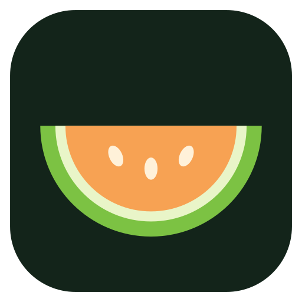
</p>

<h1 align="center">kavunOS</h1>

<p align="center">
  <b>Eski Android TV'ler için hızlı, Apple TV tarzı bir ana ekran.</b><br>
  <i>A fast, Apple TV–style home screen for old Android TVs.</i>
</p>

kavunOS, [cleanyourtv](https://github.com/Gathin23/cleanyourtv) projesinin (Gathin, MIT lisansı) üzerine kurulmuştur.
cleanyourtv'nin reklam ve gereksiz uygulama temizleme araçları ile başlatıcısı temel alınmış; ana ekran baştan,
tvOS'tan esinlenerek yeniden yazılmıştır. Orijinal projenin belgeleri [CLEANYOURTV.md](CLEANYOURTV.md) dosyasındadır.

İki önceliği var, bu sırayla:

1. **Hız.** Zayıf bir TV çubuğunda bile her tuşa anında tepki vermesi.
2. **Estetik.** Apple'ın modern tasarım anlayışı: sade, cam görünümlü, yumuşak geçişli.

## Görüntüler

| | |
|---|---|
| 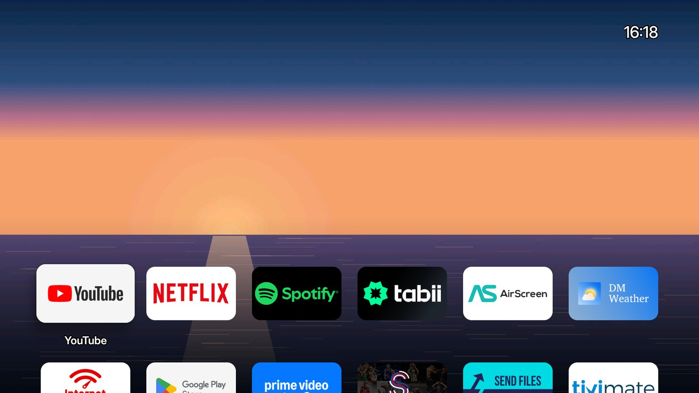 | 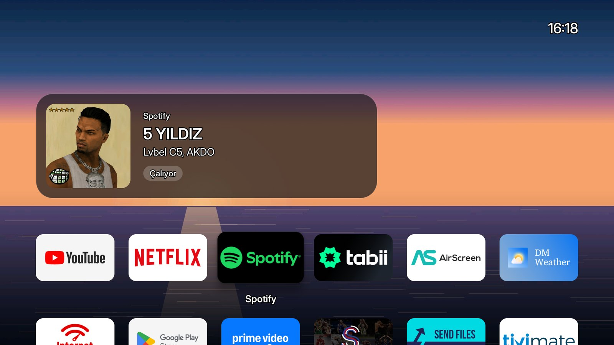 |
| *Ana ekran* | *Önizleme kartı* |
| 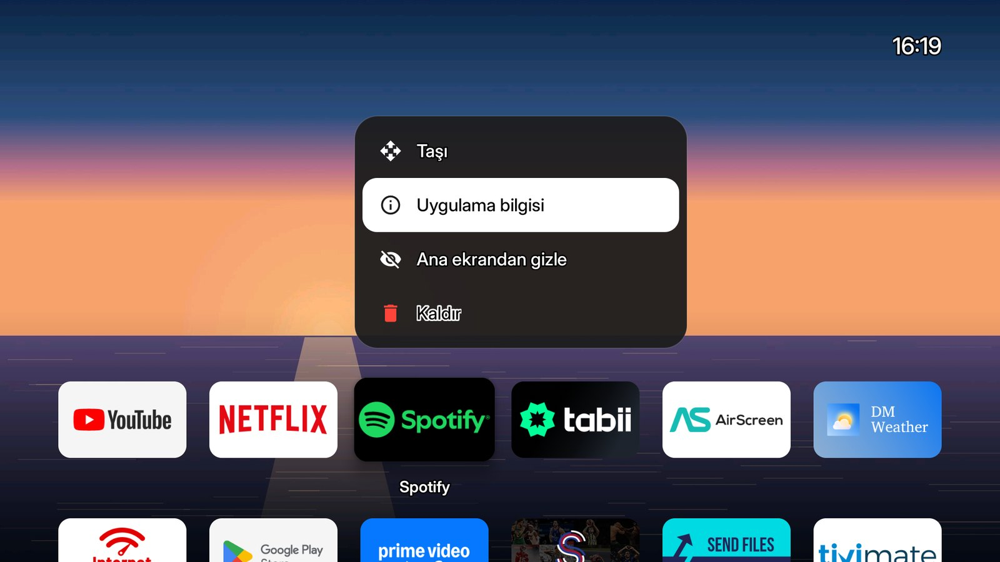 | 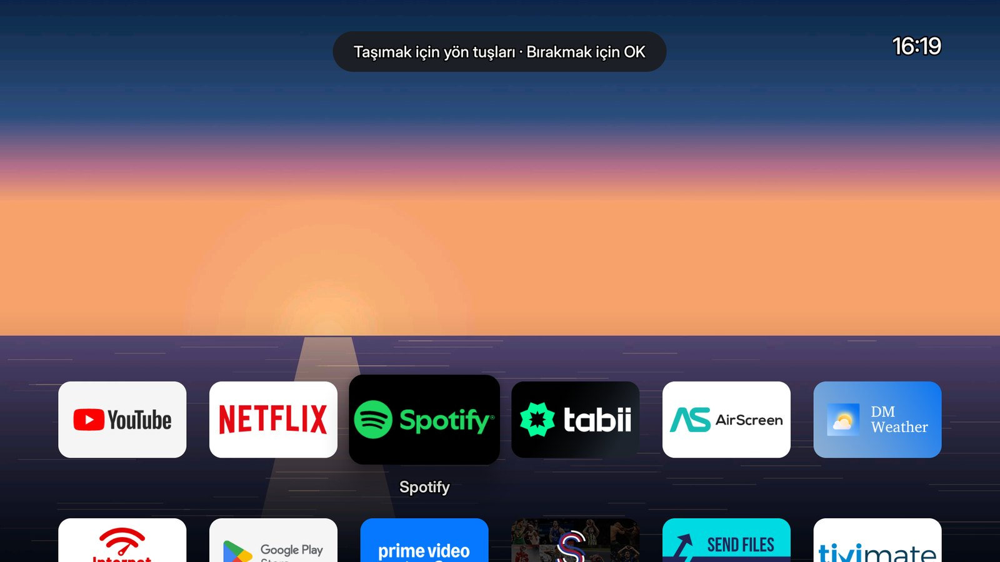 |
| *Basılı tutma menüsü* | *Taşıma modu* |
| 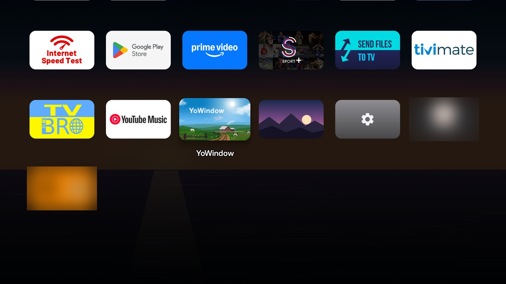 | 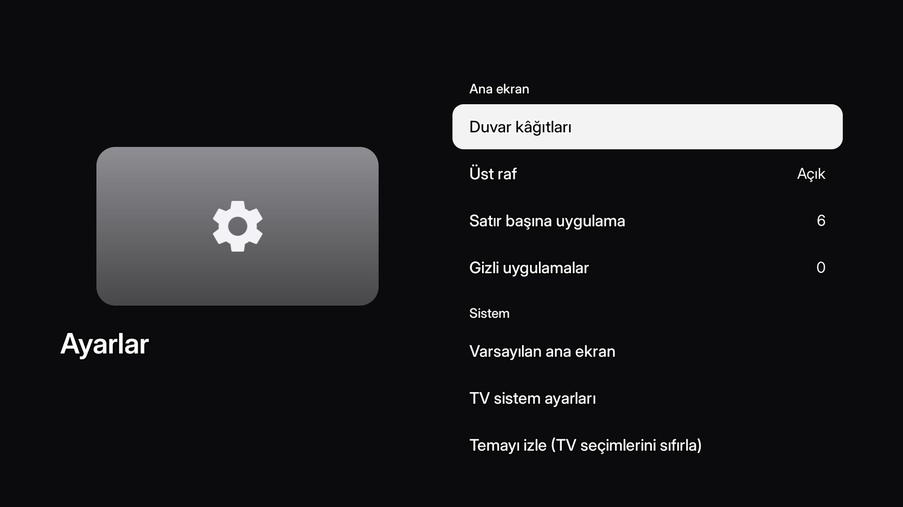 |
| *Tüm uygulamalar* | *Ayarlar* |
| 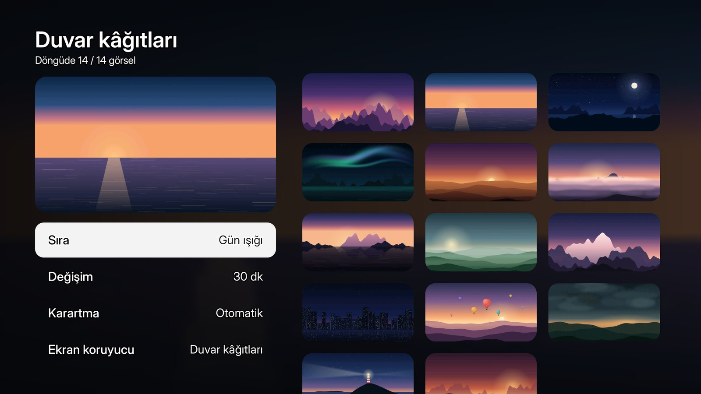 | 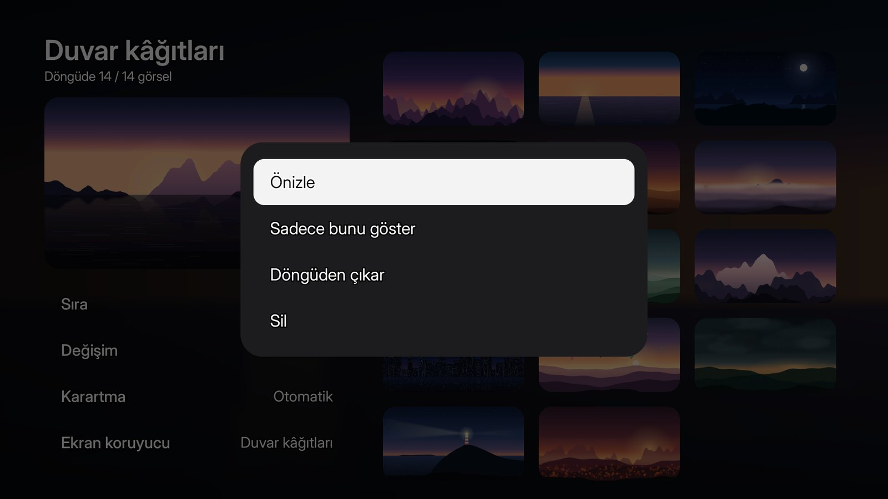 |
| *Duvar kâğıtları* | *Duvar kâğıdı seçenekleri* |
| 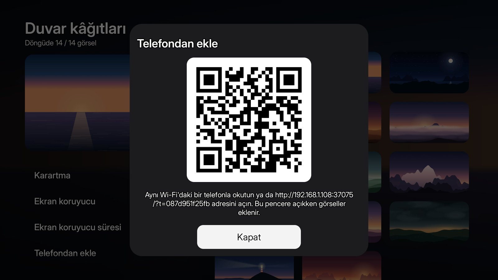 | 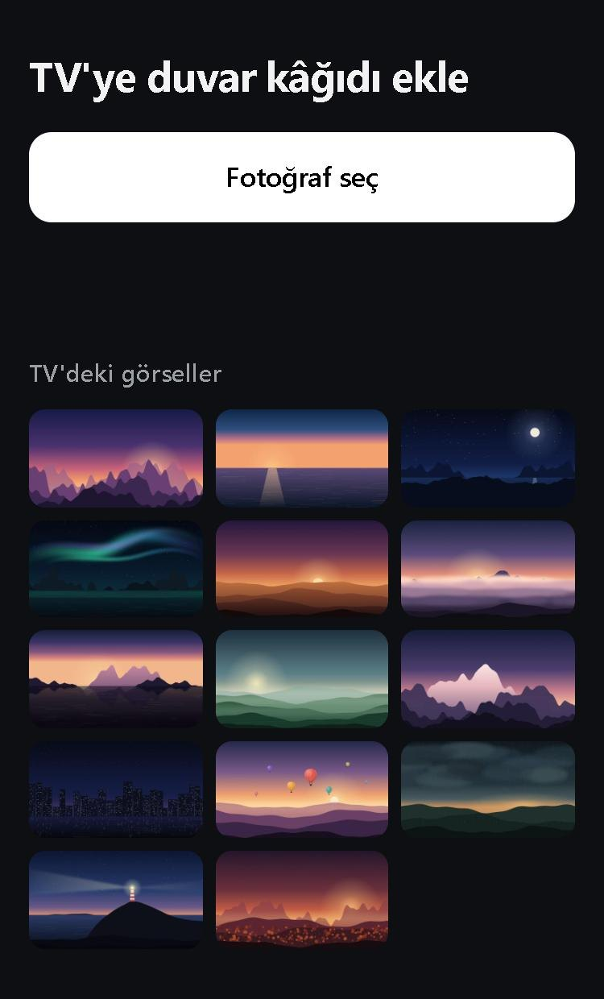 |
| *Telefondan ekle: QR'yi okutun* | *Telefondaki sayfa* |

Görüntülerdeki duvar kâğıdı depodaki ücretsiz [scenes](themes/scenes) temasından.

## Özellikler

- **tvOS tarzı ana ekran:** tam ekran duvar kâğıdı, alçakta duran ilk sıra, sağ üstte saat. Aşağı inildikçe
  duvar kâğıdı kararır, Geri ya da Home ilk sıraya döndürür.
- **Önizleme kartı:** ilk sıradaki bir uygulamanın üstünde biraz durunca, içinde ne çaldığını (şarkı, video,
  kapak, oynatılıyor/duraklatıldı) ya da en son ne zaman açıldığını gösteren cam bir kart çıkar.
- **Kontrol Merkezi:** Home'a basılı tutunca sağdan açılır. Saat, şu an çalan (önceki/oynat/sonraki), Wi-Fi,
  Bluetooth (hoparlöre yeniden bağlanma), arka plandaki uygulamaları kapatma, ekran koruyucu, duvar kâğıtları
  ve ayarlar.
- **Basılı tutma menüsü:** bir uygulamanın üstünde OK'e basılı tutunca *Taşı*, *Uygulama bilgisi*, *Ana
  ekrandan gizle* ve *Kaldır*. Taşırken uygulama sallanır, diğerleri kayarak yer açar; sıra kaydedilir.
  Gizlenenler Ayarlar → Gizli uygulamalar'dan geri getirilir.
- **Duvar kâğıtları:** karışık, sıralı, günün saatine göre ya da sabit; otomatik karartma; telefondan
  duvar kâğıdı ekleme; duvar kâğıtlarıyla ekran koruyucu.
- **Kumanda tuşları (ana ekranda):** ≡ odaktaki uygulamanın menüsü, INFO uygulama bilgisi, LAST son açılan
  uygulama, Favorite odaktakini en başa taşır, CH ∧/∨ iki satır atlar, 1–9 ve 0 ilk on uygulamayı açar; renkli
  tuşlar Kontrol Merkezi (kırmızı), Duvar kâğıtları (yeşil), Ayarlar (turuncu) ve ekran koruyucu (mavi); SAT ve EPG
  uydu TV'yi açar. Uygulamaların içinde tuşlar uygulamaya gider.
- **Inter yazı tipi**, Türkçe dahil 23 dil.

## Hız

Xiaomi Mi TV Stick 4K (Android 11, 2 GB) üzerinde, ilk cleanyourtv başlatıcısıyla karşılaştırma:

| | Önce | kavunOS |
|---|---|---|
| Bir uygulamadan ana ekrana dönüş | 669 ms | ~320 ms |
| Ana ekranı yeniden açma | 1244 ms | ~450 ms |
| Bellek | 126 MB | 63–100 MB |
| Ana ekran boşta beklerken çizilen kare | — | 35 saniyede 1 |
| Uygulama boyutu | 532 KB | 430 KB |

Ana ekran boşta beklerken hiçbir şey çizmez; animasyonlar yalnızca bir tuşa basıldığında çalışır.
Ölçmek için: `tools\perf.ps1 -TvHost <TV'nin IP'si>`.

## Kurulum

TV'de geliştirici seçeneklerini ve ağ üzerinden hata ayıklamayı açın (ayrıntılar
[CLEANYOURTV.md](CLEANYOURTV.md#quick-start) içinde). Sonra Windows'ta:

```powershell
powershell -ExecutionPolicy Bypass -File launcher\build-and-install.ps1 -TvHost 192.168.1.50 -HomeKeyService -PhoneUpload
```

macOS/Linux'ta:

```bash
TV_HOST=192.168.1.50 HOME_KEY_SERVICE=1 PHONE_UPLOAD=1 launcher/build-and-install.sh
```

- `-HomeKeyService`: kumandanın Home tuşunu kavunOS'a yönlendirir ve basılı tutunca Kontrol Merkezi'ni açar
  (Xiaomi çubukları için gerekli).
- `-PhoneUpload`: telefondan duvar kâğıdı eklemeyi açar; ağ izni yalnızca bu seçenekle eklenir.

Betik derler, kurar, kavunOS'u ana ekran yapar; ana ekran ona geçmezse eski başlatıcıyı geri getirir.
Gerekli JDK 17 ve Android SDK, Android Studio ile gelir.

## Test edilen cihazlar

- Xiaomi Mi TV Stick 4K (MiTV-AYFR0, Android 11) — temizleme listesi:
  [examples/xiaomi-mitv-ayfr0](examples/xiaomi-mitv-ayfr0/debloat.txt)
- Hiremco Matrix PRO MAX (Android 12, Allwinner, 4 GB) — `-StockLauncher com.qstar.blue -HomeKeyService` ile;
  kumandanın renkli ve SAT tuşları F-tuşu gönderir, kavunOS bunları ana ekranda tanır.

Bir kumanda tuşunun ne gönderdiğini görmek için: `adb shell setprop log.tag.kavunOS.Key DEBUG`, tuşlara basın,
`adb logcat -s kavunOS.Key` (Home tuşu servisi açık olmalı).

Diğer cihazlarda da çalışması beklenir; cleanyourtv'nin 170'ten fazla TV modeli için temizleme listeleri
[examples](examples/README.md) klasöründe duruyor.

## Teşekkür ve lisans

- [cleanyourtv](https://github.com/Gathin23/cleanyourtv) — Gathin ve katkıda bulunanlar (MIT). kavunOS onların
  çalışmasının üzerine kuruludur; bu deponun geçmişinde onların commit'leri de yer alır.
- [Inter](https://rsms.me/inter/) yazı tipi — SIL Open Font License ([launcher/INTER-LICENSE-OFL.txt](launcher/INTER-LICENSE-OFL.txt)).

MIT lisansı: [LICENSE](LICENSE).
